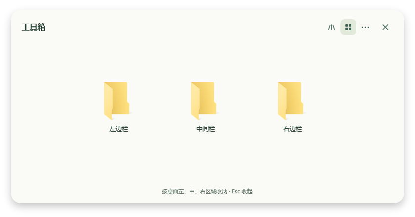
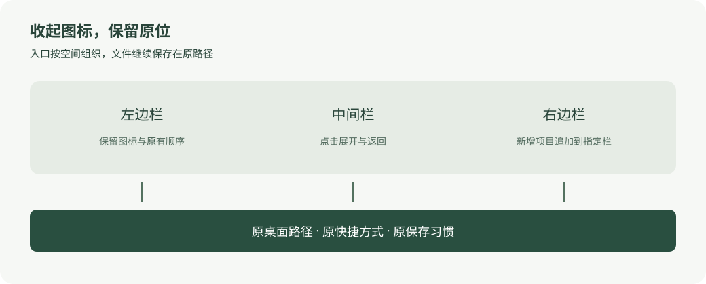

# Desktop Stacks · 桌面收纳

**收起图标，保留原位。** 一个受 macOS Stacks 交互启发的 Windows 原生桌面收纳原型。

点击一个入口，以动效展开“左边栏 / 中间栏 / 右边栏”。保留用户已经认识的图标、名称和桌面位置习惯；文件仍在原来的桌面路径，快捷方式及依赖原路径的工作流无需因收纳而搬家。





## 为什么做这个项目

设计出发点来自真实办公中的一个矛盾：希望桌面清爽，同时又不能搬动自动化程序、保存习惯和快捷方式已经引用的文件。

本项目选择把“怎么展示入口”和“文件实际放在哪里”分开处理：

- **沿用空间记忆。** 左、中、右首先对应原桌面的物理区域；不替用户重新发明一套业务分类。
- **保留视觉识别。** 原文件图标、文件夹预览和完整名称继续使用；只为收纳程序设计一个新入口图标。
- **引用原件。** 收纳目录里是导航快捷方式；点选时打开原路径，不复制业务资料来营造整齐。
- **允许收回。** 只收起桌面视图，原目录在另存为中保持可见；可以恢复，收纳不是备份。
- **动效服务选取。** 通过展开和收回帮助理解层级，保留键盘导航及系统减少动画偏好。

更完整的产品取舍与边界见 [设计思路](docs/DESIGN.md)。

## 当前能做什么

| 能力 | 行为 |
| --- | --- |
| 三个空间分区 | 初始化时读取桌面可见图标位置，按桌面宽度三等分；每区按行、列保序 |
| 网格 / 扇形入口 | 单实例、托盘、Esc 返回、屏幕边界和滚动适配 |
| 原图标 | 使用本机 Windows Shell 提取；仓库不分发第三方应用图标 |
| 可恢复收起 | 仅关闭当前桌面的原生图标显示，保留可拖动、记住位置的独立桌面入口；不改文件属性 |
| 新文件自动收纳 | 默认追加左边栏末尾，可改为中间或右边；等待保存稳定且无写入占用 |
| 登录后台启动 | 当前用户 Startup 快捷方式，不创建服务或计划任务 |

**这是早期 Windows 原型。** 已在 Windows 10 / .NET Framework 4.x 验证构建、隔离收纳测试及 WPF 自检；Windows 11、多显示器和混合缩放仍需要更多实机反馈。空间三等分是初始建议，不等于自动理解用户分组；可用自定义布局文件指定分区。

## 运行

需要 64 位 Windows 10 或更新版本、Windows PowerShell 5.1 和 .NET Framework 4.x。没有 npm、NuGet 或联网运行时依赖。

```powershell
# 在项目根目录，用 Windows PowerShell 运行
powershell.exe -NoProfile -ExecutionPolicy Bypass -File .\Build.ps1
.\dist\DesktopStacks\DesktopStacks.exe
```

从开发工具或会清理子进程的终端中启动常驻实例时，使用构建包内的独立启动入口：

```powershell
.\dist\DesktopStacks\Start-Resident.ps1 -Background
```

它使用 Windows 的独立进程创建接口，校验程序不属于调用工具的 Job，并记录本机 `resident-launch.jsonl`；不新增服务或计划任务。普通双击及 Windows 登录启动仍使用原 exe。若旧实例仍属于临时 Job，应先从程序菜单正常退出，再使用此入口启动。

首次运行只初始化当前用户桌面**可见**项目的导航，并增加 `Desktop Stacks` 入口。**桌面收起、自动收纳新文件、登录启动默认均关闭**。在菜单中按需要启用；程序退出后停止检测，下次运行可补录新增项目。

要采用自定义分区，可在首次运行前初始化：

```powershell
.\dist\DesktopStacks\Initialize.ps1 `
  -AppDirectory .\dist\DesktopStacks `
  -LayoutPath .\my-layout.json
```

`my-layout.json` 是只留在您电脑上的本地配置，例如：

```json
[
  { "source": "C:\\Users\\YOUR_NAME\\Desktop\\Example.txt", "group": "左边栏", "x": 0, "y": 0 }
]
```

自定义文件来源仍限制为桌面顶层。公共桌面需要显式 `-IncludePublic`，涉及公共快捷方式的隐藏/恢复可能出现 Windows 管理员确认。已经初始化的目录不会被初始化脚本覆盖。

## 原件与自动化

- 不移动、重命名、删除业务原件；正常收纳不设置文件或目录的 Hidden 属性。
- 不改原快捷方式的目标、参数、工作目录、ACL 或所有权。
- 原路径和原可见性保持；另存为、普通资源管理器及按可见文件枚举的工作流继续使用原目录。独立入口挂在桌面层，正常应用窗口可以遮住它。
- Office 临时文件、未完成下载、系统项目、未跟踪的原隐藏项目不自动收纳。
- 选择“恢复已收纳桌面图标”会先暂停自动收纳，避免立即重新隐藏；登录启动可单独关闭。
- 桌面显示开关保存在 `桌面显示模式.json`；新文件导航保存在 `自动收纳记录.json`。删除原件不会被收纳程序“恢复”。桌面显示层作用于当前桌面，请勿同时启用多个同类桌面控制器。

## 从旧版迁移

旧版曾通过 Hidden 属性清理桌面，导致另存为窗口看不到原文件夹；此方案已经撤换。若旧安装中存在恢复快照，请先退出旧程序，在运行目录执行：

```powershell
powershell.exe -NoProfile -STA -ExecutionPolicy Bypass -File .\恢复旧隐藏属性.ps1 -AllowElevation
```

此命令只根据旧快照恢复属性和旧系统显示值，不移动资料；公共桌面可能需要Windows管理员确认。再启动新版并从菜单收起桌面。请保留旧快照，勿删除原件。

## 开发与验证

```powershell
powershell.exe -NoProfile -STA -ExecutionPolicy Bypass -File .\Test.ps1
```

测试只在新建的 `work/` 合成目录内写文件，不隐藏真实桌面，不触发业务应用、登录启动或提权。覆盖文件/目录/快捷方式、同名冲突、保存占用、暂停、改名、删除、损坏记录、通用初始化、WPF 导航及无副作用恢复预检。

```text
src/        WPF 展开层、自动收纳与 Shell 图像读取
scripts/    读取桌面位置、初始化、隐藏和恢复
assets/     本项目原创入口图标
docs/       设计思路与使用说明
tests/      使用合成资料的集成测试
```

桌面文件名、真实路径、快捷方式、图标缓存、恢复快照和录屏都属于本机运行数据，不提交到仓库。提交反馈也请使用合成资料。见 [贡献说明](CONTRIBUTING.md)。

## 构思与许可

产品构思与交互方向：[@yangpengwei1-droid](https://github.com/yangpengwei1-droid)。实现过程使用了 AI 辅助；设计决策、用户反馈和验证边界以本仓库文档为准。

采用 [MIT 许可证](LICENSE)。macOS、Windows 及第三方软件名称和原图标属于各自权利人；本项目不附带这些软件，也不表示与其存在关联。

## English

Desktop Stacks is an early native Windows prototype that separates desktop presentation from file storage. It animates three spatial groups, reuses original Shell icons and opens original paths. Optional auto-collection appends new desktop items without moving them. Desktop-only presentation and login startup are opt-in. Files keep their original visibility in Save As dialogs; restoration pauses auto-collection. The public repository contains source and synthetic examples only, with no personal desktop configuration.
